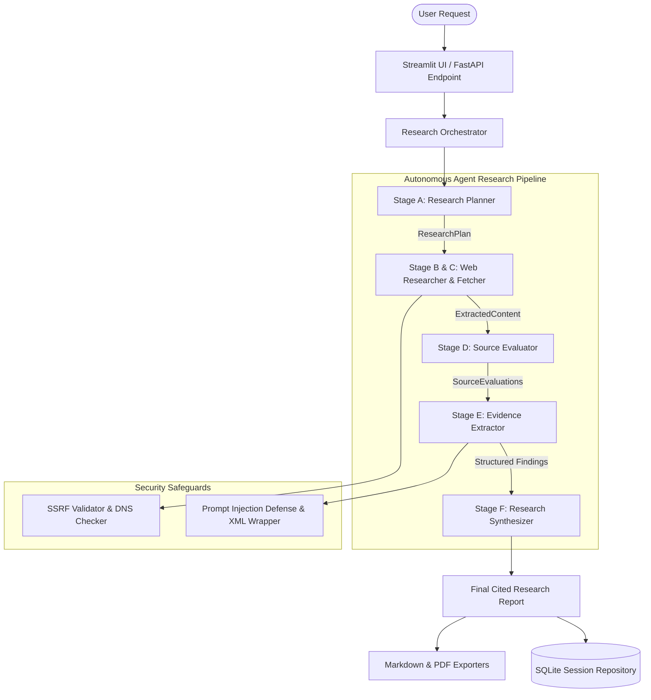

# 🔍 Deep Research AI

**Tagline:** Research smarter. Verify sources. Discover insights.

Deep Research AI is a production-quality, autonomous AI research agent designed to investigate complex topics, execute real multi-step web searches, evaluate source credibility, extract structured evidence, and synthesize verified reports with clickable citations.

---

## 🌟 Key Features

- **Autonomous Research Planning:** Decomposes complex queries into focused subquestions and search engine vectors.
- **Real Web Search & Fetching:** Multi-provider search (Tavily API with DuckDuckGo fallback) with HTML text cleaning.
- **SSRF & Security Safeguards:** IP resolution validation against loopback, private networks, cloud metadata endpoints, and prompt injection defense.
- **Source Evaluation:** Transparent evaluation of publisher authority, relevance, recency, and credibility signals.
- **Evidence Extraction:** Verifiable claims tied directly to retrieved excerpts and source URLs.
- **Verifiable Citations:** Reports formatted with numbered inline citations `[1]`, `[2]` linking to real reference sources.
- **Multi-Format Export:** Instant download as Markdown (`.md`) or publication-ready PDF (`.pdf`).
- **Interactive UI & REST API:** Full-featured Streamlit interface and FastAPI backend.

---

## 🏗️ Architecture



---

## 🛠️ Technology Stack

- **Language & Runtime:** Python 3.12+
- **Backend API:** FastAPI, Uvicorn, Pydantic v2, HTTPX
- **LLM SDK:** Google GenAI SDK (`google-genai` / `google.generativeai`)
- **Web Search & Scrape:** Tavily API, DuckDuckGo Search, BeautifulSoup4
- **Frontend UI:** Streamlit
- **PDF Export:** FPDF2
- **Database:** SQLite
- **Testing:** Pytest, Pytest-Asyncio

---

## 🚀 Quickstart & Setup Guide

### 1. Prerequisites
- Python 3.12 or higher installed.
- Free Google Gemini API Key.

### 2. Environment Setup
Navigate to the project directory on D: drive:
```bash
cd D:\deep-research-ai
python -m venv venv
venv\Scripts\activate
pip install -r requirements.txt
```

### 3. Configure API Keys
Copy `.env.example` to `.env`:
```bash
cp .env.example .env
```
Edit `.env` and set your API keys:
```env
GEMINI_API_KEY=your_gemini_api_key_here
GEMINI_MODEL=gemini-2.5-flash
TAVILY_API_KEY=your_tavily_api_key_here  # Optional: DuckDuckGo fallback used if omitted
```

#### How to Obtain API Keys:
- **Google Gemini API Key (Free):** Visit [Google AI Studio](https://aistudio.google.com/) and click **Get API Key**.
- **Tavily Search API Key (Free Tier):** Visit [Tavily AI](https://tavily.com/) for 1,000 free searches/month.

---

## 🏃 Running the Application

### Option A: Streamlit Interactive UI
```bash
streamlit run frontend/streamlit_app.py
```
Open your browser at `http://localhost:8501`.

### Option B: FastAPI Backend Server
```bash
uvicorn app.main:app --reload --port 8000
```
Access interactive OpenAPI docs at `http://localhost:8000/docs`.

---

## 🧪 Running Automated Tests

Run the complete test suite:
```bash
pytest -v
```

---

## 💡 Example Research Questions

- *"How is generative AI changing software engineering jobs in India in 2026?"*
- *"What are the current breakthroughs and challenges in solid-state battery commercialization?"*
- *"What is the economic impact of global remote work policies post-2025?"*

---

## 🔒 Known Limitations & Free-Tier Scope

- **Rate Limits:** Provider free tiers may limit total concurrent searches. The orchestrator caps requests to safe defaults (`MAX_PAGES_PROCESSED=15`).
- **Paywalled Sites:** Sites requiring login or heavy anti-bot protections return restricted status and are gracefully excluded from synthesis.

---

## 📄 License

MIT License. Built for portfolio demonstration.
