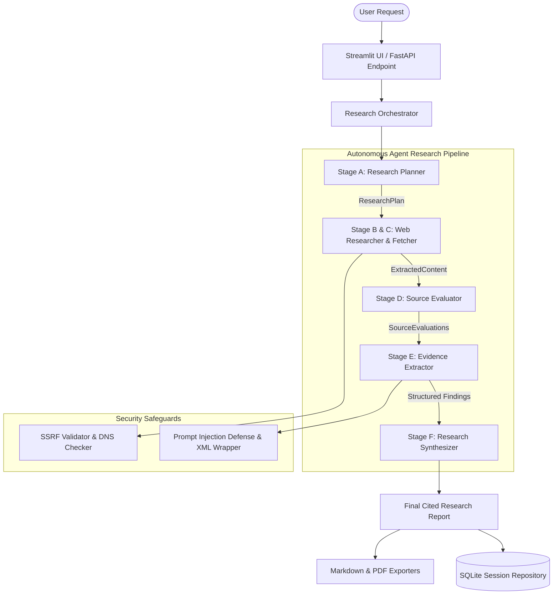

# Deep Research AI — System Architecture

## Architecture Overview

Deep Research AI is built using a modular, orchestrated multi-agent design pattern. Rather than relying on an unconstrained autonomous loop, the system executes an observable, deterministic 6-stage research pipeline.

---

## Core Components & Responsibilities

| Component | Responsibility | Key Classes / Files |
| :--- | :--- | :--- |
| **LLM Abstraction** | Unified interface for Google Gemini API (`google-genai` SDK) with schema enforcement and fallback. | `BaseLLMProvider`, `GeminiLLMProvider` |
| **Research Planner** | Decomposes research question into subquestions and high-precision search engine vectors. | `ResearchPlanner`, `ResearchPlan` |
| **Web Search & Fetcher** | Fetches deduplicated web results with SSRF validation, DNS verification, and HTML extraction. | `WebSearchTool`, `AsyncWebFetcher`, `HTMLContentExtractor` |
| **Source Evaluator** | Assesses authority, relevance, recency, and credibility signals with transparent reasoning. | `SourceEvaluator`, `SourceEvaluation` |
| **Evidence Extractor** | Extracts verbatim evidence excerpts, factual claims, and confidence scores from untrusted web pages. | `EvidenceExtractor`, `Finding` |
| **Research Synthesizer** | Synthesizes evidence into a structured markdown report with numbered inline citations `[1]`, `[2]`. | `ResearchSynthesizer`, `ResearchReport` |
| **Export Service** | Converts reports into publication-grade Markdown and PDF downloads. | `ExportService`, `FPDF` |
| **Storage Repository** | SQLite persistence for research history. | `ResearchRepository`, `database.py` |
